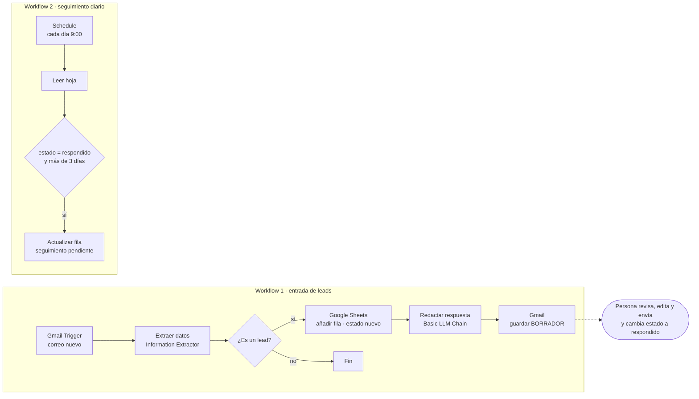

# n8n-lead-intake

Prototipo de automatización en [n8n](https://n8n.io) para gestionar las solicitudes comerciales que llegan por email a una empresa (ficticia) de charter y compraventa de yates.

Es un prototipo para portfolio: muestra el enfoque y la estructura, no es un sistema en producción. Más abajo detallo qué está comprobado y qué no.

## Qué problema resuelve

En una empresa pequeña de charter y compraventa, las solicitudes llegan por email en varios idiomas y con información muy desigual. Alguien tiene que leerlas, pasar los datos a una hoja, contestar y acordarse de hacer seguimiento. Es trabajo repetitivo y es fácil que algún lead se quede sin respuesta.

Este prototipo:

1. Lee cada correo nuevo y extrae los datos del cliente con un modelo de lenguaje.
2. Descarta lo que no es una solicitud (spam, publicidad, proveedores).
3. Registra el lead en Google Sheets con estado `nuevo`.
4. Prepara un **borrador** de respuesta en el idioma del cliente, que una persona revisa y envía.
5. Cada mañana marca los leads que llevan más de 3 días en `respondido` sin avanzar.

## Flujo



Estados de un lead: `nuevo` → `respondido` (cambio manual) → `seguimiento pendiente` (automático). El equipo puede añadir los estados que quiera a partir de ahí; el workflow de seguimiento solo mira `respondido`.

## Contenido del repo

| Ruta | Qué es |
|---|---|
| `docker-compose.yml` | n8n en local con volumen persistente |
| `.env.example` | Variables de entorno necesarias (sin valores secretos) |
| `workflows/01-lead-intake.json` | Workflow principal |
| `workflows/02-seguimiento.json` | Workflow de seguimiento diario |
| `docs/prompt-extraccion.md` | Prompt de sistema del nodo de extracción |
| `docs/prompt-redaccion.md` | Prompt de sistema del nodo de redacción |
| `templates/leads.csv` | Cabeceras de la hoja de Google Sheets |
| `samples/` | 5 correos de prueba ficticios |

Los prompts de `docs/` son exactamente los que llevan los workflows. Si cambias uno, cámbialo también en el nodo correspondiente.

## Cómo levantarlo

Requisitos: Docker con Docker Compose, una cuenta de Google (Gmail y Sheets) y una API key de OpenAI.

```bash
cp .env.example .env
# rellena N8N_ENCRYPTION_KEY, por ejemplo con: openssl rand -hex 32
docker compose up -d
```

n8n queda en <http://localhost:5678>. La primera vez pide crear un usuario propietario local.

Los datos de n8n (workflows, credenciales cifradas, historial de ejecuciones) se guardan en el volumen `n8n_data`, así que sobreviven a `docker compose down`. Para borrarlo todo: `docker compose down -v`.

## Preparar la hoja de Google Sheets

1. Crea una hoja nueva e importa `templates/leads.csv` (Archivo → Importar). Así tendrás la fila de cabeceras.
2. Renombra la pestaña a `leads`.
3. Selecciona la columna `fecha_estado` y ponle formato de texto sin formato (Formato → Número → Texto sin formato). Si no lo haces, Google Sheets convierte las fechas que escribas a mano al formato de tu región y el workflow de seguimiento no las podrá leer.
4. Copia el ID de la hoja: es la parte de la URL entre `/d/` y `/edit`.

## Importar los workflows

Desde la interfaz: en n8n, crea un workflow vacío, abre el menú `...` de la cabecera, elige importar desde archivo (*From file*) y selecciona el JSON de `workflows/`. Repite con el segundo.

Desde la línea de comandos (la carpeta `workflows/` está montada en el contenedor):

```bash
docker compose exec n8n n8n import:workflow --separate --input=/workflows
```

Los workflows se importan sin publicar (inactivos) y sin credenciales.

## Conectar credenciales

Los nodos que necesitan credencial aparecen con un aviso rojo hasta que se la asignas.

**Google (Gmail y Sheets).** Necesitas un proyecto en Google Cloud con la Gmail API y la Google Sheets API activadas y un cliente OAuth de tipo "Aplicación web". Como URI de redirección autorizada usa la que te muestra n8n al crear la credencial (en local es `http://localhost:5678/rest/oauth2-credential/callback`). Después, en n8n, crea una credencial *Gmail OAuth2* y otra *Google Sheets OAuth2* con ese Client ID y Client Secret. La guía oficial está en <https://docs.n8n.io/integrations/builtin/credentials/google/oauth-single-service/>.

**OpenAI.** Crea una credencial *OpenAI* con tu API key y asígnala a los dos nodos de modelo (`Modelo extracción` y `Modelo redacción`).

Después de asignar credenciales:

1. En los nodos de Google Sheets (`Añadir a la hoja`, `Leer hoja` y `Marcar seguimiento pendiente`), sustituye `REEMPLAZAR_CON_ID_DE_TU_HOJA` por el ID de tu hoja, o elígela de la lista.
2. Prueba cada workflow con **Execute workflow** antes de activarlo.
3. Publica los dos workflows con el botón **Publish**. En n8n 2.x es lo que los activa.

## Probar con los correos de ejemplo

En `samples/` hay cinco correos ficticios en formato `.eml`:

| Archivo | Caso |
|---|---|
| `01-charter-es.eml` | Charter en Baleares, español, con todos los datos |
| `02-compra-en.eml` | Compra de un velero de segunda mano, inglés |
| `03-venta-de.eml` | Venta de una motora, alemán, sin teléfono ni presupuesto |
| `04-incompleto-es.eml` | Solicitud muy vaga: casi todos los campos deberían salir `null` |
| `05-spam.eml` | Publicidad de SEO: no es un lead y no debería llegar a la hoja |

Para probarlos, envía el texto de cada uno a la bandeja conectada desde otra cuenta. Lo que hay que mirar: que los campos que no aparecen en el correo queden vacíos y no inventados, que el borrador esté en el idioma del cliente y que el spam no genere fila ni borrador.

Todos los nombres, direcciones y teléfonos son inventados. Los dominios son `example.*`, reservados para documentación.

## Decisiones de diseño

**Revisión humana antes de enviar.** El workflow nunca envía correos: guarda un borrador en el mismo hilo de Gmail. Un modelo de lenguaje puede entender mal una solicitud o usar un tono que no toca, y en una venta de este importe una mala primera respuesta sale cara. Además, el prompt le prohíbe hablar de precios, disponibilidad o plazos, que es lo que debe decidir una persona.

**No inventar datos.** El esquema de extracción obliga a devolver todos los campos, pero cada uno puede ser `null`. El prompt insiste en copiar solo lo que aparece en el correo. Es preferible una celda vacía a un dato plausible pero falso en la hoja comercial.

**Filtrar lo que no es un lead.** El mismo paso de extracción devuelve `es_lead`. Si es `false`, el flujo se detiene. Así el spam no ensucia la hoja ni gasta una segunda llamada al modelo.

**RGPD.** Los correos contienen datos personales (nombre, email, teléfono). En este prototipo:

- n8n corre en tu propia máquina y las credenciales se guardan cifradas en el volumen local.
- El contenido del correo **sí se envía a OpenAI** para la extracción y la redacción. En un uso real haría falta revisar el acuerdo de tratamiento de datos con el proveedor, o cambiar los nodos de modelo por uno que corra en local (n8n tiene nodo para Ollama, por ejemplo).
- La hoja solo guarda los campos necesarios para gestionar la solicitud. Faltaría definir un plazo de conservación y una forma de borrar un lead si el cliente lo pide.
- El repo no contiene ninguna credencial; `.env` está en `.gitignore`.

**Por qué n8n self-hosted.** Los flujos se ven como diagrama, así que una persona no técnica del equipo puede entender qué pasa con cada correo. Al ser self-hosted, los datos no pasan por la plataforma de un tercero, salvo las llamadas que haces tú (Google y el proveedor del modelo). Y los workflows son JSON, así que se pueden versionar en git como aquí.

## Qué está comprobado y qué no

Comprobado con n8n **2.43.7** (la versión fijada en `docker-compose.yml`):

- Los dos workflows se importan sin errores.
- Los tipos de nodo, sus versiones y los nombres de los parámetros coinciden con el código de los nodos de esa versión. Pasé los workflows por la validación de parámetros de n8n y el único aviso que queda es el de credenciales sin asignar.
- El esquema de extracción acepta `null` en los campos opcionales y rechaza un `servicio` fuera de la lista.

No comprobado:

- **No he ejecutado los workflows de principio a fin con cuentas reales** de Gmail, Google Sheets y OpenAI. Las expresiones que leen la salida de cada nodo (`$json.output`, `$json.text`, `from.value[0].address`, etc.) están escritas según el código de los nodos, pero no las he visto funcionar con datos reales.
- El modelo `gpt-5-mini` es el que n8n propone por defecto en esa versión. Si tu cuenta no tiene acceso a él, elige otro en los nodos de modelo. También se puede cambiar el nodo por el de otro proveedor (Anthropic, Gemini, Ollama...).
- La calidad de la extracción y de los borradores depende del modelo y de los prompts. No hay una batería de pruebas que la mida.

## Limitaciones y próximos pasos

- **El paso a `respondido` es manual.** Quien envía el borrador tiene que cambiar el estado y la fecha en la hoja. El siguiente paso sería detectar automáticamente que el borrador se ha enviado (por ejemplo, buscando mensajes enviados en el hilo).
- **Duplicados.** Si un cliente escribe dos veces, se crean dos filas. Se podría buscar el email en la hoja antes de añadir.
- **Aviso de seguimiento.** Ahora mismo solo se marca la fila. Se podría enviar además un resumen diario por email o a un canal del equipo.
- **Errores.** No hay workflow de errores. Si falla la llamada al modelo o a Google, el correo no se procesa y solo queda constancia en el historial de ejecuciones de n8n.
- **Adjuntos.** No se leen; muchas solicitudes de compraventa traen fichas o fotos en PDF.
- **Google Sheets como base de datos.** Sirve para un prototipo y es cómodo para el equipo comercial, pero con volumen o varias personas editando a la vez convendría un CRM o una base de datos.
- **Evaluación.** Haría falta un conjunto de correos etiquetados para medir la extracción y revisar los prompts con datos.
